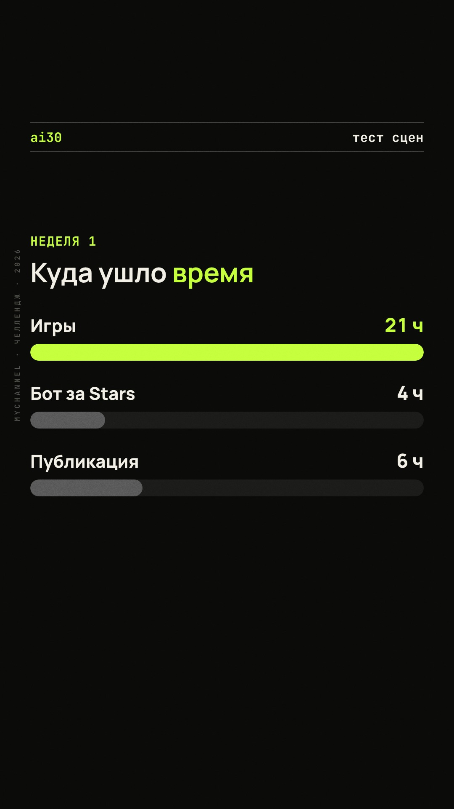

# reels-engine

Движок вертикальных роликов (Reels / Shorts / TikTok), где всё рисует код: JSON-сценарий превращается в MP4 1080×1920, 30 fps, H.264 + AAC, плюс обложка в jpg. Лиц и стоковых видео нет, звук тоже синтезируется кодом.



## Зачем

Я делаю короткие ролики для канала-эксперимента и хотел, чтобы выпуск был данными, а не проектом в видеоредакторе: правка текста в JSON, команда, готовый MP4. Тогда серию из десятков роликов можно держать в git, перерисовывать после смены брендкита и рендерить в фоне.

## Стек

Node.js 18+, Playwright (Chromium), ffmpeg/ffprobe. Одна npm-зависимость (`playwright`). Для озвучки по желанию: Edge TTS (Python `edge-tts`), Silero TTS (Python, PyTorch), ElevenLabs (HTTP API).

## Архитектура и решения

```
сценарий.json ──► render.js ──► engine/ (HTML+CSS+JS страница)
                     │              renderFrame(t) выставляет весь DOM по времени t
                     ├─ Playwright: снимок кадра (PNG/JPEG) → пайп в ffmpeg (x264)
                     ├─ lib/audio.js: музыка + SFX синтезируются в Node (WAV)
                     └─ lib/narration.js + lib/tts/*: озвучка, кэш voice-cache/
```

Выбран вариант HTML/CSS/JS + Playwright + ffmpeg, а свой рантайм анимаций написан вместо GSAP и вместо Remotion:

- **Детерминизм.** Каждый кадр — чистая функция от времени `t`: `renderFrame(t)` выставляет весь DOM, затем делается снимок. В движке нет CSS-анимаций, таймеров и `requestAnimationFrame`, поэтому кадр N всегда одинаковый, а рендер делится на параллельные куски (`--workers`).
- **Без сборки и CDN.** Remotion тянет React, бандлер и свой Chromium. Здесь одна зависимость, шрифты лежат в проекте, рендер работает офлайн.
- **Скорость доводки.** Новая сцена — это одна функция в `engine/engine.js`, без перекомпиляции.
- **Звук без чужих файлов.** Музыка (бочка, хэт, клэп, бас, пэд, арпеджио) и эффекты синтезируются в `lib/audio.js`, лицензионных вопросов нет.
- **Проверка макета до рендера.** Для схем (`flow`) движок меряет карточки и падает с ошибкой, а не выдаёт ролик с вылезшим текстом.

## Запуск

```bash
npm install
npx playwright install chromium          # один раз
node render.js examples/showcase.json    # ≈10 секунд, результат в out/showcase.mp4 и out/showcase.jpg
```

Нужен `ffmpeg` в PATH. `examples/showcase.json` не требует озвучки. В `examples/ai30-day1.json`, `examples/systems-hq.json` озвучка включена: для `edge` нужен `pip3 install --user edge-tts`, для `silero` и `elevenlabs` см. раздел «Озвучка». Кэш озвучки (`voice-cache/`) в репозиторий не входит, при первом запуске голос синтезируется заново. Без озвучки: `--no-audio`.

Рендер на удалённой машине (например, WSL на домашнем ПК): `REELS_HOST=<ssh-алиас> ./remote-render.sh examples/showcase.json`. Скрипт синхронизирует проект, рендерит там и забирает `out/` обратно.

Флаги `render.js`:

| флаг | что делает |
|---|---|
| `--frames 1,5.5,12` | только PNG-кадры в эти секунды → `out/<name>-frames/` (быстрая проверка) |
| `--safe` | закрашивает запретные зоны: верхние 220 px и нижние 380 px |
| `--cover-only` | переснимает только обложку |
| `--workers 2` | параллельные страницы браузера (по умолчанию 2) |
| `--crf 22 --maxrate 2200 --preset medium` | x264: CRF с потолком битрейта в кбит/с (по умолчанию 22 и 2200, это ≈ 8 МБ на 30 с вместе со звуком) |
| `--voice ru-RU-SvetlanaNeural` | подменить голос озвучки из сценария |
| `--voice-only` | только синтез озвучки в `voice-cache/` и печать итоговых длительностей сцен |
| `--no-layout-check` | не падать на проверке схем |
| `--no-audio` | без звука |

Что получается на выходе: `out/<name>.mp4` (H.264 high, yuv420p, AAC 128k, faststart) и `out/<name>.jpg`. Обложка — это кадр `cover.t` без субтитров и полосы прогресса.

## Сценарий (JSON)

```json
{
  "name": "ai30-day1",            // только латиница: это имя файла
  "channel": "challenge",         // ключ из channels.json
  "header": { "left": "ai30", "right": "день 1/30" },
  "cover": { "t": 2.4 },
  "music": { "enabled": true, "bpm": 108, "seed": 30 },   // переопределяет channels.json
  "voiceover": { "provider": "edge", "voice": "ru-RU-DmitryNeural" },
  "captions": true, "grain": true, "progressBar": true,
  "scenes": [ { "type": "headline", "duration": 3.4, "text": "Я дал *ИИ* ...", "caption": "..." } ]
}
```

`*слово*` выделяет текст акцентным цветом. Работает в заголовках, субтитрах, чатах и подписях.

Пути к картинкам указываются относительно файла сценария.

### Типы сцен

| type | ключевые поля |
|---|---|
| `headline` | `text`, `kicker`, `sub`, `align: center`, `marker: true`, `stagger`, `size`. Слова влетают по одному, размер шрифта подбирается сам |
| `counter` | `label`, `prefix`, `from`, `to`, `unit`, `roll`, `rollMax`, `countDur`, `stamp`, `sub`. Если `from == to`, работает как слот-машина и в конце останавливается на значении |
| `terminal` | `title`, `kicker`, `windowTitle`, `cps`, `height`, `lines: [{cmd}, {out, tone: ok/err/muted, gap}, {pause}]` |
| `chat` | `messages: [{from: ai/human, text, typing}]`, `aiName`, `status`, `title`. Тайминг считается сам и подгоняется под длительность сцены |
| `browser` | `url`, `image`, `title`, `kicker`, `badge`, `badgeAt` |
| `checklist` | `title`, `items: [{text, state: done/fail/todo, note}]` |
| `chart` | `title`, `bars: [{label, value, accent, display}]`, `unit`, `decimals` |
| `flow` | `nodes: [{id, label, sub, icon, x, y, at, part}]` (x и y от 0 до 1), `edges: [{from, to, curve, bidir}]`, `focus`. Иконки лежат в `engine/icons.js` |
| `phone` | `screens: [{image, title}]` — карусель в макете телефона |

Общие поля любой сцены:

- `duration` — длительность;
- `caption` — строка (`|` задаёт принудительную разбивку) или массив `[{t, text}]` с точными таймингами;
- `transition: "cut"` — склейка без перехода.

### Субтитры

Субтитры вшиваются в видео. Строка режется на фразы до ~30 символов, время делится по длине фраз, текущее слово подсвечивается акцентом. Блок субтитров прижат к y=1520, то есть заканчивается выше нижней зоны в 380 px.

### Звук

`lib/audio.js` синтезирует трек прямо в Node: бочка, хэт, клэп, бас, пэд, арпеджио. Аккорды задаются через `mode` (`minor`, `dark`, `major`), тональность — через `root` (MIDI), сид — через `seed`. Трек полностью свой, чужого аудио в нём нет.

Звуковые эффекты (pop, whoosh, blip, tick, fail, key, hit) движок сам расставляет по событиям сцен. Например, каждое слово заголовка даёт pop, а смена сцены — whoosh.

### Озвучка

Edge TTS (`pip3 install --user edge-tts`, голоса `ru-RU-DmitryNeural` и `ru-RU-SvetlanaNeural`). Включается в сценарии:

```json
"voiceover": { "provider": "edge", "voice": "ru-RU-DmitryNeural", "rate": "+8%", "lead": 0.25, "pad": 0.4, "gap": 0.2, "musicGain": 0.8 }
```

Текст кладётся в сцену полем `voice`: строка или массив фраз. Фраза может быть объектом `{ "text": "...", "say": "..." }` — `text` идёт в субтитры, `say` читает голос (так правятся произношения: «и-и», «Си-эр-эм»).

- Длительность сцены = `lead` + длина всех фраз + паузы + `pad`, но не меньше `minDuration` сцены (нужен там, где анимации длиннее речи).
- Если у сцены нет `caption`, субтитры строятся из фраз `voice` и привязаны к реальному времени голоса.
- В `flow` узел с `"part": N` появляется на N-й фразе; в `phone` смена экранов идёт по фразам, если их столько же, сколько экранов.
- Музыка приглушается под голосом: sidechain-компрессор (`"duck": false` выключает), плюс статичный `musicGain`. Голос нормализуется до −16 LUFS.
- Готовая запись: `"voiceover": {"file": "vo.wav", "offset": 0, "gain": 1, "musicGain": 0.35}`. Свой провайдер: `lib/tts/<name>.js` с `synthesize({ text, segments, outFile, options })`.

Озвучка синтезируется один раз и кэшируется в `voice-cache/` (ключ — голос, скорость и текст), `remote-render.sh` увозит кэш на удалённую машину вместе с проектом, поэтому там `edge-tts` ставить не нужно. Сервис Microsoft отвечает нестабильно (403 / «No audio»), поэтому `lib/tts/edge.js` держит паузу 4 с между запросами и повторяет до 24 раз. Запросы идут по одному: в параллель сервис отказывает ещё чаще.

### Проверка схем (`flow`)

Подписи узлов: название и подпись по 44 px, карточка 452 px. При сборке сцены движок меряет границы карточек и падает с ошибкой, если подпись мельче 44 px (`minFont` в сцене меняет порог), карточка вылезает за поле сцены 952×950, текст не помещается по ширине или карточки пересекаются. Такой рендер не начнётся: исправьте макет или передайте `--no-layout-check`.

## Каналы (темы оформления)

Тема канала — объект в `channels.json`; ключ указывается в сценарии (`"channel": "challenge"`). В репозитории лежит `channels.example.json` с двумя темами: `challenge` (лайм на почти чёрном, плоский фон, зерно, шкала из 30 делений, субтитры JetBrains Mono) и `infra` (янтарь, точечная сетка, субтитры Manrope). Если `channels.json` нет, берётся пример; свою тему можно положить в `channels.json` (он в `.gitignore`).

Градиентов и свечения нет, музыка тихий эмбиент (`music.style: "ambient"`) с ducking под голосом.

Сцены брендкита: `hook` (номер дня огромным моно + заголовок, `tag` красной меткой), `quote` (карточка цитаты), `stampcard` (заголовок и штамп), `timeline` (шкала дней). В `checklist` пункт привязывается к фразе озвучки: `"part": N, "dt": секунды`. Шапка: `"header": {"left": "...", "right": "...", "scale": {"total": 30, "filled": 1}}`.

## Раскладка кадра

| зона | что там |
|---|---|
| 0–220 px | запретная зона, пусто |
| 236–308 px | шапка канала и полоса прогресса |
| 340–1290 px | сцена |
| ~1360–1520 px | субтитры |
| 1540–1920 px | запретная зона, пусто |

## Озвучка: провайдеры

- **Edge TTS** — `pip3 install --user edge-tts`; голоса `ru-RU-DmitryNeural`, `ru-RU-SvetlanaNeural`.
- **Silero** (`"provider": "silero", "model": "v5_ru", "voice": "aidar"`) — синтез на CPU. Если есть `~/silero-tts/venv`, идёт локально; иначе по ssh на удалённую машину: задайте `SILERO_HOST` и `SILERO_USER`. Ударения: в поле `say` перед ударной гласной ставится `+`; латиница и цифры в `say` запрещены (Silero их молча пропускает, движок падает с ошибкой).
- **ElevenLabs** (`lib/tts/elevenlabs.js`) — ключ из `ELEVENLABS_API_KEY` или из macOS Keychain (сервис `elevenlabs-api-key`), передаётся в curl через stdin, в argv и логи не попадает. Прокси (`ELEVENLABS_PROXY`) нужен там, где API недоступен напрямую. Псевдонимы голосов — в `voices.json` (образец `voices.example.json`). Результат кэшируется по (голос, модель, настройки, текст), повторная фраза кредитов не тратит.

## Режим desktop-cinema

Отдельный режим в `cinema/`: светлый пастельный стол, реальные записи экранов и нарисованные окна в CSS 3D, камера пролетает от окна к окну, курсор с кликами, глубина резкости, LED-агент с мимикой по огибающей голоса. Старый движок от него не зависит.

```bash
node cinema/prepare.js my-clip                # озвучка ElevenLabs по сценам, тайминги слов, огибающая рта
cinema/remote.sh my-clip --frames 1,5,20       # кадры PNG на удалённой машине (нужен REELS_HOST)
cinema/local.sh my-clip                       # то же локально (нужен PWCORE)
node cinema/render-covers.js               # обложки 1080×1920 по шаблону (cover/cover.html, демо-конфиги demo1 и demo2)
```

Состав: `runtime.js`/`parts.js`/`common.js` — сцена, камера, курсор, агент, плашки, субтитры; `render-cinema.js` — покадровый рендер (x264 ≈3 Мбит/с, музыка + sidechain-ducking, loudnorm −14 LUFS); `rec.js`/`rec-jobs.js` — запись экранов живых страниц (CDP-скринкаст) в jpg-последовательности; `prepare.js` — озвучка сцен и тайминги слов.

**Важно:** раскадровки (`cinema/clips/<id>.js`) и тексты сцен (`cinema/episodes/<id>.json`, разметка `{на экране|в озвучке}`, `[тег]` — тег эмоции eleven_v3) в репозиторий не входят, как и записи экранов (`cinema/media/`) и собранные озвучки (`cinema/build/`). Режим выложен как пример архитектуры, из коробки готового клипа в нём нет. Для записи своих экранов задайте `REC_BASE` и правьте `rec-jobs.js`.

## Шрифты

Unbounded, Manrope и JetBrains Mono (лицензия SIL OFL 1.1) лежат в `assets/fonts/` и `cinema/cover/fonts/` вместе с текстами лицензий. Все три поддерживают кириллицу и ₽. Других шрифтов в репозитории нет. Галочек ✓ и ✗ в этих шрифтах нет, поэтому отметки нарисованы в SVG.

## Скорость

На MacBook (Apple Silicon, 2 воркера) `examples/showcase.json` (11,5 с, 345 кадров) рендерится за ≈9 с, около 50 кадров в секунду. На слабой машине без GPU (4 ядра, 4 ГБ) выходит 2–4 кадра в секунду: узкие места — снимок страницы в Chromium и x264 medium. Быстрее: `--preset faster` или выключенное зерно (`"grain": false`).

## Лицензия

MIT, см. `LICENSE`. Шрифты — SIL OFL 1.1 (тексты рядом с файлами).
